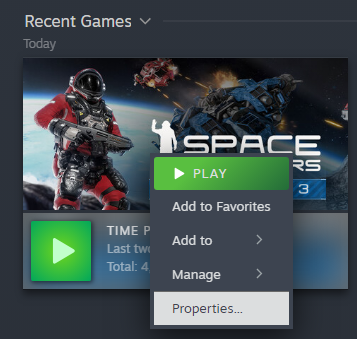
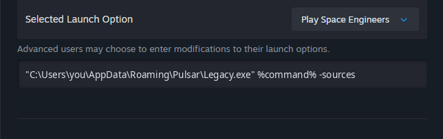
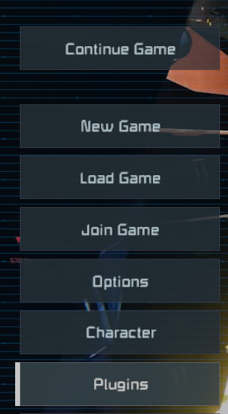
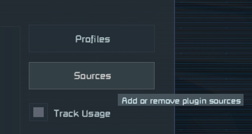
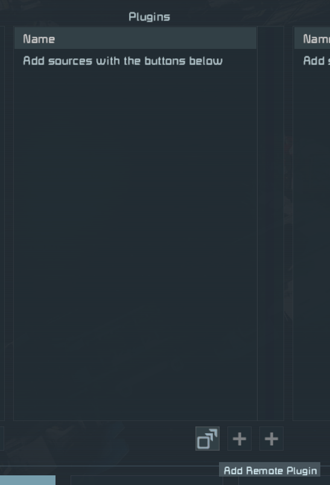
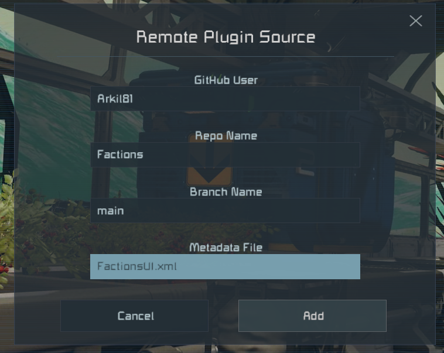
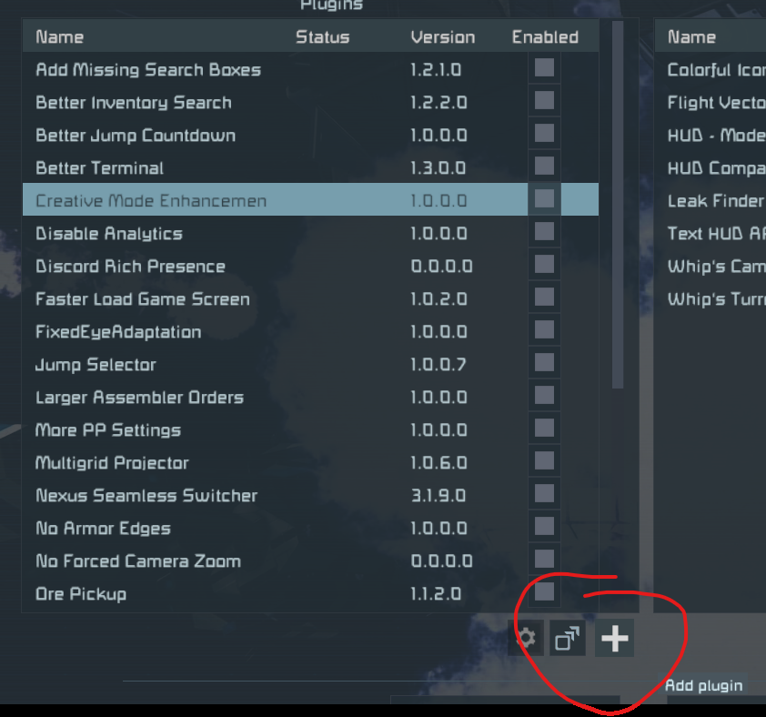
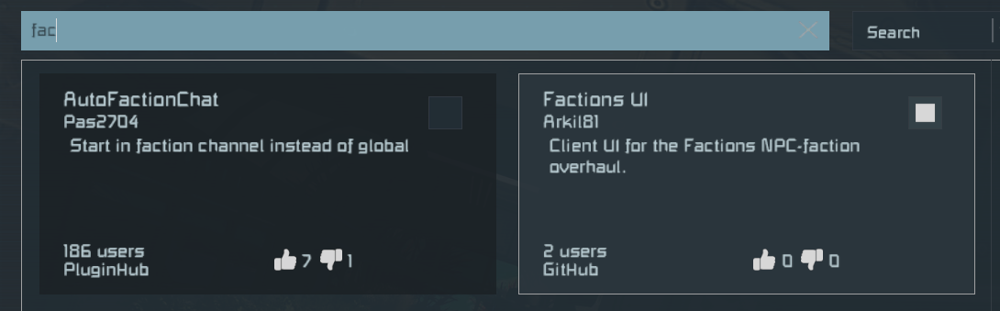
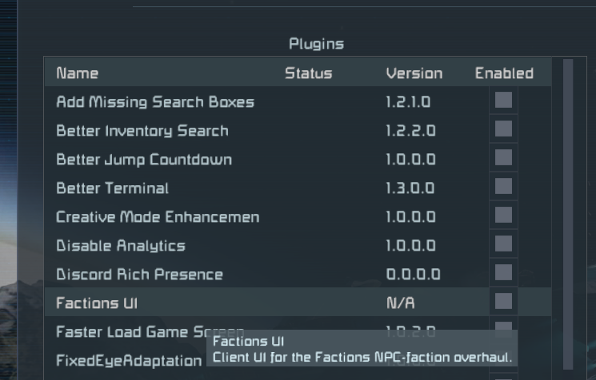

# Installing Factions UI

Factions UI is the client plugin for servers running Factions. It draws the ship scanner, map,
market, node and fleet windows, and the traffic-control voice. On a server without Factions it does
nothing.

It installs through [Pulsar](https://github.com/SpaceGT/Pulsar). Pulsar builds it from this
repository's source and keeps it up to date.

## Quick install (Windows)

1. Close Space Engineers.
2. Download and run
   [FactionsUI-Setup.exe](https://github.com/Arkil81/Factions/releases/latest/download/FactionsUI-Setup.exe).
3. Click **Install**. If Steam is running, the installer asks to close it and starts it again when it
   has finished.
4. Start Space Engineers from Steam as usual. The first start takes longer while Pulsar builds
   Factions UI.

The installer installs Pulsar into `%AppData%\Pulsar` if you do not have it, sets Space Engineers'
Steam launch options to start the game with Pulsar's `Legacy.exe`, and adds and enables Factions UI
in Pulsar. If you already use Pulsar, it keeps your other plugins, mods and launch options, and
backs up each file it changes beside the original (`.bak`). Running it again changes nothing.
**Remove Factions UI** in the same window takes Factions UI out of Pulsar again.

The installer is not code-signed, so Windows may show **Windows protected your PC** the first time.
Click **More info**, then **Run anyway**. Its source is in this repository, under
`src/FactionsInstaller`.

The installer stops without changing anything if Space Engineers' launch options start the game
through a program other than Pulsar, or pick a Pulsar profile with `-profile`. Install by hand
instead, as below.

## Install by hand

Use this on Linux, or if the installer cannot set things up for you.

### Before you start

You need two things in place before installing Factions UI.

#### 1. Pulsar

Pulsar is the plugin loader that runs Space Engineers plugins. If you do not have it yet, download
it from the [Pulsar releases page](https://github.com/SpaceGT/Pulsar/releases/latest) and follow
its installation instructions. When it is working, the Space Engineers main menu has a **Plugins**
button.

**Start the game with Pulsar's `Legacy.exe`, not `Interim.exe` or `Modern.exe`.** Pulsar comes with
three launchers. `Legacy.exe` runs Space Engineers on .NET Framework, which is what Factions UI is
built for. `Interim.exe` runs it on .NET 10, and Factions UI does not support that yet, so Pulsar
hides it from the plugin list without any message. `Modern.exe` is for Space Engineers 2. Your Steam
launch options (below) show which one you use.

#### 2. The `-sources` launch option

Pulsar normally only offers plugins from its own built-in list, and Factions UI is not on that list.
To add a plugin from somewhere else, as this guide does, Pulsar has to be started with the launch
option `-sources`. Without it, the **Sources** button used below does not appear at all.

To add the launch option in Steam:

1. In your Steam library, right-click **Space Engineers** and choose **Properties**.

   

2. On the **General** page, find the **Launch Options** box. It may already contain text, for
   example the line that makes Steam start the game through Pulsar, which ends in `%command%`.
   Leave any existing text as it is.
3. Click at the very end of the text, type a space, and then type `-sources`.
4. Close the Properties window. Steam saves the change automatically.

For example, if the box contained

```
"C:\Users\you\AppData\Roaming\Pulsar\Legacy.exe" %command%
```

it should now contain

```
"C:\Users\you\AppData\Roaming\Pulsar\Legacy.exe" %command% -sources
```

In Steam, the finished launch options look like this:



You only need to do this once. The option stays in place for every future game start.

### Install

1. Start Space Engineers and click **Plugins** in the main menu.

   

2. Click **Sources**. The first time, Pulsar shows an **External Sources Warning**: plugins can run
   any code, so only add sources you trust. Click **Acknowledge**.

   

3. The Sources window has three columns: **Hubs**, **Plugins** and **Mods**. The Hubs and Plugins
   columns each have a button with the same link icon. Use the one under **Plugins**, whose tooltip
   reads **Add Remote Plugin**. It opens a dialog titled **Remote Plugin Source** with four fields.
   If the dialog asks for a **Display Name** and has no **Metadata File**, it is the hub dialog:
   cancel it and use the button under Plugins.

   


   The quickest way to fill the dialog: copy this line to the clipboard *before* clicking the
   button, and Pulsar fills in all four fields itself:

   ```
   seplugin/Arkil81/Factions/main/FactionsUI.xml
   ```

   Or type them in:

   | Field | Value |
   |---|---|
   | GitHub User | `Arkil81` |
   | Repo Name | `Factions` |
   | Branch Name | `main` |
   | Metadata File | `FactionsUI.xml` |

   **Check the Metadata File field before you click Add. Pulsar fills it in with `PluginHub.xml`,
   which is wrong for Factions UI and easy to miss. It must read `FactionsUI.xml`.** With the wrong
   file name the source is saved anyway, and Factions UI is never offered.

   

   Click **Add**, then **Apply**.
4. Back in the plugin window, click the **+** button below the plugin list. Its tooltip reads
   **Add plugin**. The plugin list shows only the plugins you have enabled, so Factions UI is not
   in it yet.

   

   In the window that opens, type `Factions` in the search box, and tick the box on the
   **Factions UI** card. Its author is Arkil81 and its source is GitHub. Close the window.

   

   Factions UI now appears in the plugin list. Its version reads N/A until Pulsar has built it.
   Click **Apply**.

   

5. Pulsar asks to restart the game. Accept. Pulsar downloads and compiles the plugin during start-up,
   so this start takes longer than usual.

The plugin is now loaded. It connects by itself when you join a server running Factions.

## Updates

Pulsar checks this repository at game start, at most once every two hours, and builds the newest
release on its own. You do not reinstall anything.

Client and server must speak the same wire protocol, and each
[release](https://github.com/Arkil81/Factions/releases) states which one it uses. Releases are timed
to match the servers' updates. If a server updates first and your game checked for updates less
than two hours ago, restarting the game is not enough: see the next section.

### Getting a new release straight away

Pulsar keeps the time of its last check, and does not check again until two hours have passed. To
make it check every time the game starts:

1. Close Space Engineers. Pulsar rewrites its settings while the game runs, so a change made then
   is lost.
2. Open the file `Legacy\Sources\sources.xml` in your Pulsar folder, the folder that holds
   `Legacy.exe`. If your launch options contain `-useHome`, the file is
   `%AppData%\Pulsar\Legacy\Sources\sources.xml` instead.
3. Find the line `<MaxSourceAge>2</MaxSourceAge>` and change the `2` to `0`. If the file has no such
   line, add `<MaxSourceAge>0</MaxSourceAge>` on the line after the one that starts with
   `<SourcesConfig`.
4. Save the file and start the game. Pulsar checks for the new release and builds it.

The number is the time in hours between checks. You can leave it at `0`, which costs one short
check of this repository each time you start the game, or set it back to `2`.

There is also a way that does not need the file. In **Plugins** → **Sources**, remove the Factions
entry under **Plugins** and click **Apply**, then add it again as in *Install* above and click
**Apply**. A newly added source has never been checked, so Pulsar checks it at once.

## Checking that it works

The Space Engineers log is the newest `SpaceEngineers_*.log` in `%AppData%\SpaceEngineers`. Search
it for `FactionsUI:`.

| Log line | Meaning |
|---|---|
| `FactionsUI: initialised` | The plugin loaded |
| `FactionsUI: ATC voice library: <n> clips in …` | The traffic-control voices loaded |
| `FactionsUI: UPLINK_GRANTED …` | Connected to the server's Factions plugin |
| `FactionsUI: UPLINK_REFUSED protocol client=<a> server=<b>` | Client and server versions differ; see below |
| `FactionsUI: UPLINK_REQUEST sent (attempt 5/5)` with no `UPLINK_GRANTED` after it | The server is not running Factions, or did not answer |

## Troubleshooting

- **Factions UI is not offered in the Add plugin window, and the source is right.** Check that the launch options
  name `Legacy.exe`. Under `Interim.exe`, Pulsar leaves Factions UI out.
- **No Sources button.** The game was started without `-sources`; check the launch options and
  restart.
- **Factions UI is not offered in the Add plugin window.** In **Sources**, click the Factions entry under
  **Plugins** and check its **File**. It must read `FactionsUI.xml`; `PluginHub.xml` is the
  auto-filled default and the usual cause. Adding the source again does not fix it: Pulsar answers
  "This source already exists in the list." and keeps the old entry. Remove the entry, click
  **Apply**, then add it again with the right file name and click **Apply**.
- **`UPLINK_REFUSED protocol`.** The client and server are on different releases. Restart the game
  so Pulsar fetches the current release. If it still refuses, Pulsar checked less than two hours ago:
  see [Getting a new release straight away](#getting-a-new-release-straight-away). If the server is
  the older one, the client links again once the server updates.
- **Factions UI added as a hub.** Adding the repository under **Hubs** instead of **Plugins** also
  works, but Pulsar then downloads the whole repository each time it changes, instead of one small
  file. Remove the hub entry and add it under **Plugins** instead.

## Uninstall

If you used the installer, run it again and click **Remove Factions UI**. Otherwise:

Untick **Enabled** for Factions UI in the plugin list and restart. To remove it completely, also
delete the Factions entry under **Sources** → **Plugins**.
